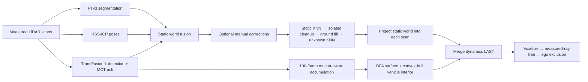

# OCC Label Generation
## From lidar point cloud to Occ label

**English** | [简体中文](README.zh-CN.md)

A LiDAR-Only pipeline for generating Occ3D/nuScenes-style semantic occupancy pseudo labels. Each scan is segmented, static geometry is reconstructed in a SLAM world frame, and tracked dynamic objects are merged **last** so static KNN and cleanup cannot change their classes.



## What is included

- Configuration-based paths; no bundled capture, private absolute paths or model weights.
- Raw NPZ + CSV recordings, or timestamped per-frame PCD folders.
- KISS-ICP odometry, PTv3 segmentation, TransFusion-L detection and continuous MCTrack tracking.
- Independent 100-frame temporal-completion blocks; static world fusion at 0.1 m.
- Static semantic KNN, isolated-component cleanup, local ground interpolation and unknown-point assignment.
- BPA object surfaces and 0.1 m convex-hull vehicle-interior samples.
- Dynamic semantic priority, including stopped/low-speed targets; no later semantic cleanup.
- Occ3D semantic IDs, measured-ray free labels, provenance masks and ego exclusion.
- Optional native six-camera + **fixed 2D top-view** player; vehicle forward is screen-up.

This release is LiDAR-only: images do not supply semantic labels or poses. `mask_camera` is all false and explicitly unavailable. Images are optional for generation; six synchronized images are required by the optional viewer.

## Quick start

**Python 3.10 and an NVIDIA CUDA GPU are the tested setup.** Python packages alone do not install the compiled Pointcept/OpenPCDet backends. Complete [installation](docs/INSTALL.md) first.

```bash
python -m pip install -r requirements.txt
python -m pip install -e .
cp configs/pcd.example.json configs/local.json
# For NPZ/CSV recordings, copy configs/npz_csv.example.json instead.
```

Edit `configs/local.json`:

1. Set `data_root` and a **new** `output_root`.
2. Set Pointcept, OpenPCDet and MCTrack checkout paths.
3. Set the PTv3 config/checkpoint and TransFusion checkpoint paths.
4. Set sensor height, ego dimensions, yaw rotation and the actual intensity field/mode.
5. Optionally set `manual_static_world` to a reviewed annotation file in this run's SLAM world frame.

Relative paths resolve against the **configuration file**, not the current directory. Example paths point outside `configs/` into `data/`, `weights/` and `third_party/`.

```bash
occ-label validate --config configs/local.json
occ-label doctor   --config configs/local.json
occ-label run      --config configs/local.json
occ-label status   --config configs/local.json
# After the complete capture is generated, with a local desktop display:
occ-label view     --config configs/local.json
```

`run` stays in the foreground. For a long unattended job:

```bash
nohup occ-label run --config configs/local.json > run.log 2>&1 &
```

No monitor, browser server, account integration or automatic viewer is created. Re-run with the same config to resume completed stages. Configuration/weight changes require a fresh output directory. Interrupting the tracking stage restarts continuous tracking; a partial temporal block is archived before reprocessing.

## Input formats

**Per-frame PCD:**

```text
data/example_capture/
  000001/
    lidar.pcd       # x, y, z in metres; configured intensity field
    meta.json       # {"lidar_time": 1234567890.123} in seconds
    F.png           # optional: FL,F,FR,BL,B,BR
  000002/...
```

**NPZ + CSV recording:**

```text
data/example_capture/
  lidar.csv         # ros_stamp_ns,file; extra columns allowed
  lidar/000000.npz  # xyz: [N,3], intensity: [N] (or configured field)
  cameras.csv       # optional: camera,wall_time_ns,file
  cameras/.../*.jpg
```

Camera role names: `front left`, `front mid`, `front right`, `back left`, `back`, `back right`. Extra cameras are ignored. Camera matching uses nearest wall timestamp to LiDAR ROS epoch timestamp, within the configured tolerance; clocks must share an epoch. Rear images are mirrored **only for display**. Missing matches do not stop LiDAR generation; the six-camera player omits incomplete image frames.

Pointwise timing is unavailable in these generic formats, so deskew is disabled. Supply already deskewed scans when motion distortion matters. Inputs are rotated by `yaw_to_vehicle_deg` once before odometry/detection/segmentation, with no point additions. Raw coordinates must be converted to **x forward, y left, z up**; metres are required.

## Output

```text
<output_root>/
  predictions/frames/<frame>/point_labels.npz
  training_labels_v1/detections/<frame>.json
  occ_pipeline_v3_0/
    config.json, run_provenance.json, status.json, *.log
    input_frames/, capture_manifest.json, slam/poses.json
    tracked_completion_all_block100/
    ball_pivoting_all_block100/
    dynamic_last_v1/
      background_world/, knn/, clean/, ground/, unknown_knn/
      interior_full_v1/
      occ_full_interior_v1/<frame>/labels.npz
```

Default grid: **200 × 200 × 16**, 0.4 m cells, bounds `[-40,-40,-1,40,40,5.4]`. `lidar_height_m=1.75` shifts raw LiDAR Z into the grid frame. The ego box is specified in that shifted frame. See [label definitions](docs/LABELS.md) for free versus unknown and supervision masks.

## Models, reproducibility and limitations

PTv3 must have the nuScenes **16-class** head and matching Pointcept config; the adapter maps channels to Occ3D IDs 1..16. You can use your own fine-tuned weights, including a compatible v2.2 model. They are not included or downloaded automatically. TransFusion must expose the standard nuScenes 10 detection classes.

Ground interpolation, KNN, BPA and convex hulls produce **inferred pseudo labels**, not measured truth. A convex envelope can fill vehicle cabin air and bridge concavities; pedestrian/bicycle/motorcycle interiors are not filled. Detector misses or incorrect segmentation can still enter the static map. A dynamic-overwrite count of zero checks merge priority, not detection accuracy.

For intensity-only NPZ recordings, `intensity_proxy_clip255` explicitly clips intensity to [0,255] for the segmentation feature. It is **not calibrated reflectivity**, and can cause domain shift. Prefer a real reflectivity channel when available. Sensor height, model geometry, exposure-independent intensity scaling and motion distortion should be checked on a short capture before a full dataset.

CPU tests and a local three-frame integration check are documented in [verification](docs/VERIFICATION.md). External CUDA backend setup remains hardware-dependent. A clean installation on every GPU/platform has not been validated.

[Contributing](CONTRIBUTING.md) · [Third-party software and revisions](THIRD_PARTY.md) · [License status](LICENSE_STATUS.md)

## Optional manual static review

Set `manual_review: true` **before the first run**. The pipeline stops after the static world is ready, with `awaiting_manual_review` status. It does not open a GUI automatically.

```bash
occ-label annotate --config configs/local.json
# Save the edits in the native Open3D tool, close it, then:
occ-label run --config configs/local.json
```

The editor includes multiple KNN seeds, rotated screen rectangles, sphere selections and top-view ground polygons with local Z filtering. It saves a separate annotation NPZ and backups; input clouds stay unchanged. Only static labels/erasures are transferred into the static branch, and dynamic evidence remains protected. Save edits before resuming; changing annotations after downstream stages have completed requires a fresh run/output rather than silently reusing stale products. This interactive editor uses 3D interaction for labeling; the final OCC playback remains fixed 2D.
